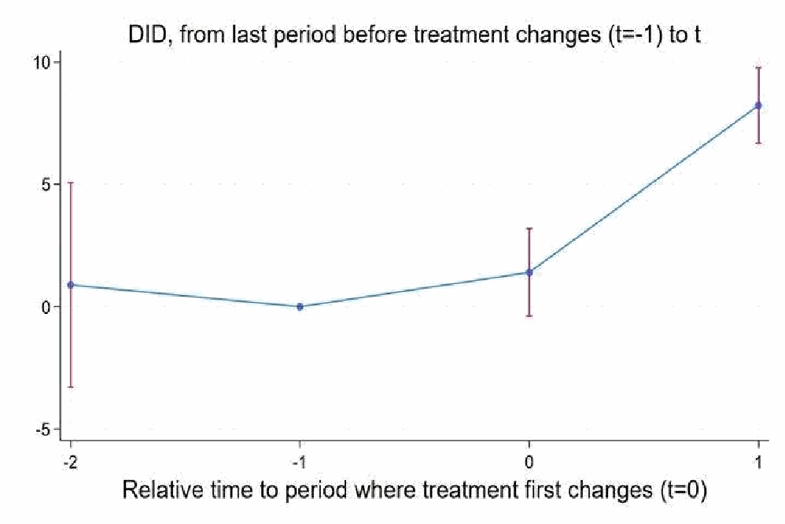

# How Mobile Money Affects Individuals' Economic Behaviour — A Staggered DiD Analysis

**M1 Empirical Project, Aix-Marseille School of Economics (2026)**

Group project: Yun Hao, **Mariam Abdillahi Ahmed**, Kelly Hillah

📄 [Full report (PDF)](./report/mobile_money_empirical_report.pdf)

## My contribution

- **Wrote the report**: I turned the team's analysis into the final research paper.
- **Built the staggered Difference-in-Differences model**: the treatment definition (country reaches a "High" Mobile Money Prevalence Index), the treatment timing and event time, excluding always-treated countries, and the event-study estimation with the **de Chaisemartin & D'Haultfœuille** estimator (`did_multiplegt`) for consumption, savings and investment. See the *SDID* section of [`code/02_staggered_did_twfe_heterogeneity.do`](./code/02_staggered_did_twfe_heterogeneity.do).

My teammates did the data collection and merge, the continuous-treatment TWFE models, the robustness checks and the heterogeneity analysis.

## Research question

Does reaching a **high level of mobile-money adoption** causally change a country's **household consumption**, **gross savings** and **investment** (gross fixed capital formation)?

## Data

An unbalanced country-year panel, **2020–2023**, built from two sources:
- **GSMA Mobile Money Prevalence Index (MMPI)**, an ordinal index from "Very low" to "Very high", recoded 1–5 → the treatment.
- **World Bank World Development Indicators**: the outcomes and the controls (GDP per capita, inflation, secondary school enrolment, trade openness, mobile subscriptions).

## Method

1. **Staggered DiD.** Treatment = MMPI ≥ 4 ("High" or "Very high"). Countries switch into treatment in different years, so standard two-way fixed effects can be biased under heterogeneous effects. I used the **de Chaisemartin & D'Haultfœuille** estimator with dynamic effects, placebo (pre-trend) tests and country-clustered bootstrap standard errors.
2. **TWFE with a continuous treatment** (MMPI level), with and without controls.
3. **Robustness checks**: a lower treatment threshold (MMPI ≥ 3), alternative samples, a log outcome and country-specific trends.
4. **Heterogeneity** by income level and education level.

## Key results

| Outcome | Result |
|---|---|
| Household consumption per capita | No significant effect, in both the DiD and the TWFE models |
| Gross savings (% of GDP) | **+8.2 pp one year after** reaching high adoption; average effect on treated countries 2.77 pp (significant at 10%) |
| Investment (% of GDP) | **+1.8 pp one year after** reaching high adoption (significant at 1%) |

These lagged effects do **not** appear in the TWFE model. They come from **crossing an adoption threshold**, not from small increases in mobile money use.

*Event study: effect of high MMPI on gross domestic savings (% of GDP).*

**Limitations:** a short 4-year panel, few switching countries (5–6), and country-level aggregates that can hide household-level and informal-sector effects.

## How to reproduce

Run the do-files in Stata from this folder (`mobile-money-staggered-did/`):

| File | Purpose |
|---|---|
| `code/01_data_cleaning_merge.do` | Clean WDI and GSMA data and merge them into `merged_data.dta` (the raw downloads are not included) |
| `code/02_staggered_did_twfe_heterogeneity.do` | Staggered DiD, TWFE, heterogeneity analysis |
| `code/03_robustness_checks.do` | Robustness checks (MMPI ≥ 3 threshold, alternative samples and specifications) |

Required packages: `did_multiplegt`, `event_plot`, `reghdfe`, `ftools`, `estout`, `gtools` (installed with `ssc install` inside the scripts).

**Data sources:** GSMA Mobile Money Metrics (MMPI 2020–2023); World Bank, World Development Indicators.
