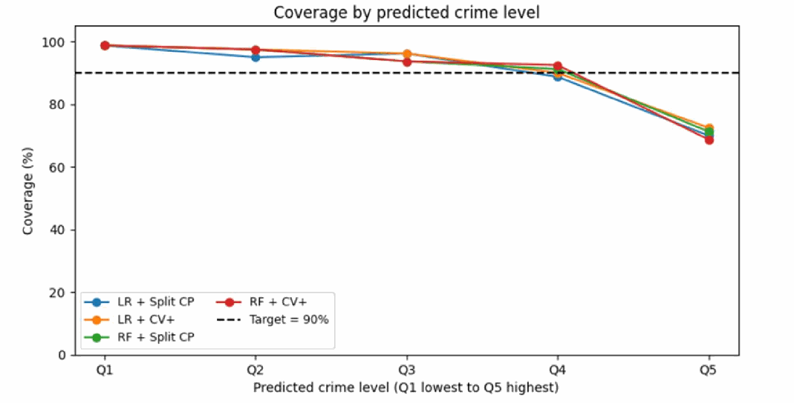

# Quantifying Uncertainty in Violent Crime Prediction — A Conformal Prediction Approach

**M2 Machine Learning Final Project, Aix-Marseille School of Economics (2026)**
Group project: Kelly Hillah, **Mariam Abdillahi Ahmed**, Chaima El Hadad, Ouiam El Ghalbzouri
📄 [Full report (PDF)](./report/violent_crime_conformal_prediction_report.pdf) · 📓 [Notebook](./notebook/violent_crime_conformal_prediction.ipynb)

## My contribution

- **Data preprocessing** (the *Preprocessing* section of the notebook): handling missing values (dropping the LEMAS police variables, which are ~84% missing), type conversion, duplicate checks, removing non-predictive identifiers, analysing the target distribution, correlation analysis (finding strong multicollinearity) and checking outliers.
- **Conformal prediction** (the *Conformal Prediction* section of the notebook): **Split Conformal Prediction** and **Cross-Validation+ (10 folds)** applied to the two best models, evaluated with coverage (RCS), mean interval width (RMWS) and RMSE, plus a **conditional coverage analysis by predicted crime level**.

My teammates built and tuned the point-prediction models (Linear Regression, Decision Tree, Random Forest and Neural Network).

## Research question

Given a community's socio-economic, demographic and housing characteristics, how well can we predict its violent crime rate, and **how reliable is the uncertainty around these predictions**?

## Data

[UCI Communities and Crime](https://archive.ics.uci.edu/dataset/183/communities+and+crime) (Redmond, 2009): 1,994 U.S. communities with 127 attributes from the 1990 Census, the LEMAS survey and the 1995 FBI Uniform Crime Reports. The target is `ViolentCrimesPerPop` (normalised to [0, 1]). The notebook downloads the data directly with `ucimlrepo`.

## Results

**Point prediction (test set):**

| Model | RMSE | MAE | R² |
|---|---|---|---|
| Linear Regression | 0.1389 | 0.0956 | 0.636 |
| Decision Tree | 0.1586 | 0.1097 | 0.526 |
| **Random Forest** | **0.1385** | **0.0910** | **0.639** |
| Neural Network | 0.1448 | 0.0971 | 0.605 |

**Conformal prediction (90% target, 399 test communities):**

| Model | Method | Coverage | Mean width |
|---|---|---|---|
| Linear Regression | Split CP | 89.7% | 0.409 |
| Linear Regression | CV+ | 91.0% | 0.449 |
| Random Forest | Split CP | 90.5% | 0.416 |
| Random Forest | CV+ | 90.2% | 0.441 |

All four combinations reach close to 90% coverage overall, and Split CP gives narrower intervals. **But this overall coverage hides a large gap:** coverage is about 99% in the lowest-crime group and falls to **69–73% in the highest-crime group**. A model can look well calibrated on average and still be unreliable exactly where it matters most.



## How to run

```bash
pip install -r requirements.txt
jupyter notebook notebook/violent_crime_conformal_prediction.ipynb
```
